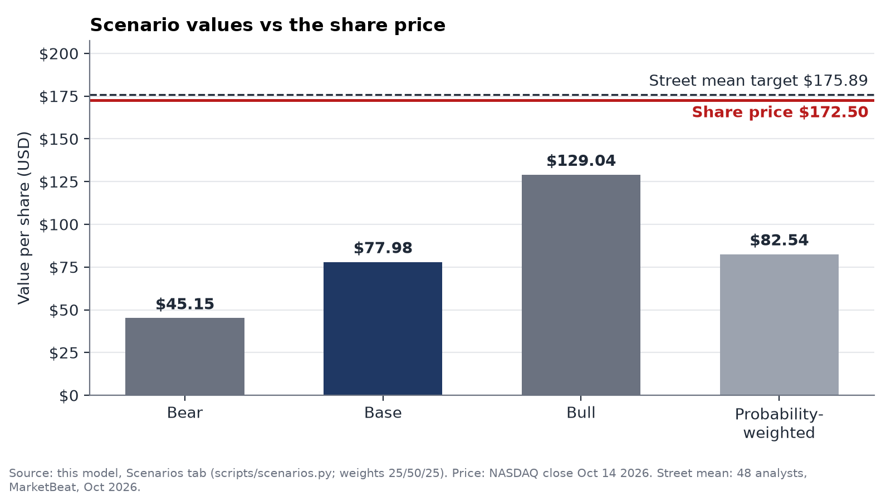
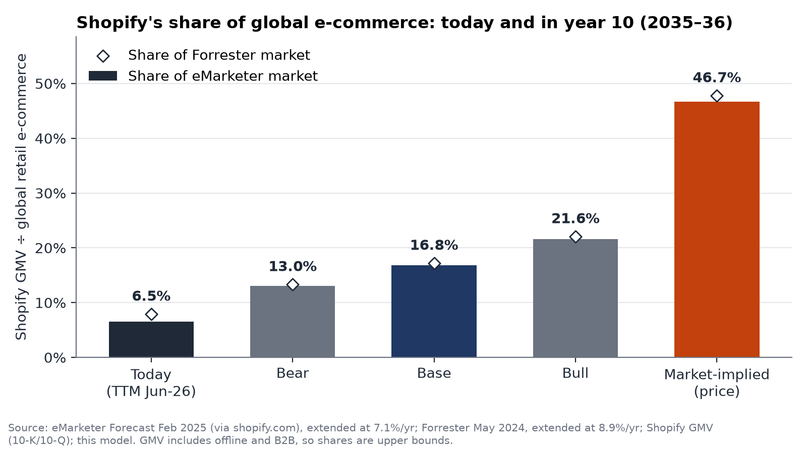
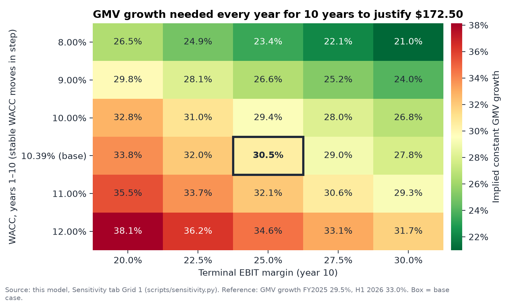

# Shopify Reverse DCF

A reverse DCF that solves for the GMV growth Shopify's current share price implies. It then translates that growth into the share of global e-commerce Shopify would need.

## Key results

- **Price used:** \$172.50, the NASDAQ close on Oct 14, 2026.
- **Implied GMV growth:** 30.5% a year for 10 years, against 29.5% in FY2025 and 33.0% in H1 2026.
- **Implied market share:** 46.7% of global retail e-commerce in year 10 (2035–36) vs 6.5% today (eMarketer); 47.8% vs 7.9% (Forrester).
- **Value per share:** base \$77.98, bear \$45.15, bull \$129.04, at a 10.39% WACC in the base case. All three are below the price.
- **Main conclusion:** the price assumes close to today's growth pace for a decade, a higher path than the bull case.

The full model is an Excel workbook: [Download shopify_reverse_dcf.xlsx](model/shopify_reverse_dcf.xlsx)

Each assumption is explained in [memo/justification.md](memo/justification.md) and logged in [memo/decisions.md](memo/decisions.md).

## Contents

- [Objective](#objective)
- [Data](#data)
- [Method](#method)
- [Results](#results)
- [Conclusions](#conclusions)
- [Limitations](#limitations)
- [License](#license)

## Objective

What does Shopify's share price assume about its growth, and how large would Shopify have to become for that to hold? The project works backward from the price instead of forecasting a value first. Base, bear and bull forward DCFs give a point of comparison.

## Data

Company data comes from the SEC XBRL companyfacts API and 10-K and 10-Q filings, through the 10-Q for Jun 30, 2026 (filed Aug 5, 2026). GMV is not in XBRL, so it is read from the KPI tables in the filings. TTM means the twelve months to Jun 30, 2026.

| Input | Value | Source | As of |
|---|---|---|---|
| Share price | \$172.50 | NASDAQ close | Oct 14, 2026 |
| TTM revenue | \$13,269M | SEC filings | Jun 30, 2026 |
| TTM GMV | \$432,164M | SEC filings | Jun 30, 2026 |
| Take rate | 3.07% | TTM revenue ÷ TTM GMV | Jun 30, 2026 |
| Diluted shares | 1,290.0M | 10-Q cover page plus option and RSU dilution | Jul 31, 2026 |
| Net non-operating assets | \$9,624M | Balance sheet, after a 20% haircut on investments and \$178M of leases | Jun 30, 2026 |
| Risk-free rate | 5.21% | Fed H.15, 10-year Treasury | Oct 13, 2026 |
| Equity risk premium | 4.14% | Damodaran, implied ERP | Sep 1, 2026 |
| Industry beta | 1.25 | Damodaran, US Software (System & Application) | Jan 2026 |
| Global e-commerce, eMarketer | \$6.65T today | eMarketer forecast, as cited by Shopify | Feb 2025 |
| Global e-commerce, Forrester | \$5.45T today | Forrester press release | May 30, 2024 |

## Method

1. **Historical data:** load filings into the workbook and build TTM figures.
2. **Forecast:** GMV growth fades from 29% to 7%, take rate rises from 3.07% to 3.27%, and EBIT margin rises from 13.9% to 25%.
3. **FCFF:** after-tax EBIT plus D&A, less capex, working capital and Shopify Capital loan growth (20% of new revenue). Stock-based compensation stays in EBIT as a cost.
4. **WACC:** CAPM with an industry beta. Shopify has no debt, so WACC equals the cost of equity.
5. **Terminal value:** after year 10, beta moves to 1.00 and 26.4% of NOPAT is reinvested to fund 3% growth.
6. **Equity bridge:** enterprise value plus net non-operating assets, divided by diluted shares.
7. **Reverse solve:** find the constant 10-year GMV growth that sets value per share equal to the price, with other inputs at base case.
8. **Market-share check:** divide year-10 GMV by global e-commerce forecasts extended to 2036.

| Assumption | Value | Note |
|---|---|---|
| Risk-free rate | 5.21% | 10-year Treasury |
| Beta | 1.25 | Shopify's own 5-year beta is 2.62 |
| Equity risk premium | 4.14% | Damodaran implied |
| Debt weight | 0% | Convertible notes settled Nov 2025 |
| WACC, years 1–10 | 10.39% | 5.21% + 1.25 × 4.14% |
| WACC, after year 10 | 9.35% | Beta of 1.00 |
| Terminal growth | 3.0% | Below long-run nominal GDP of about 4% |
| Terminal ROIC | 11.35% | Stable WACC plus a 2-point moat spread |
| SBC % of revenue | 4.0% | Held flat; TTM is 3.6% |
| Tax rate | 19% to 24% | Effective rate rising over 10 years |

## Results

### Scenarios

Each scenario changes only the inputs below. Stable beta is 1.00 in all three.

| | Bear | Base | Bull |
|---|---|---|---|
| GMV growth, year 1 | 25.0% | 29.0% | 33.0% |
| GMV growth, year 10 | 5.0% | 7.0% | 9.0% |
| Take-rate increase per year | 0.00 pt | 0.02 pt | 0.03 pt |
| Terminal EBIT margin | 20.0% | 25.0% | 30.0% |
| Loan book % of revenue increase | 22.0% | 20.0% | 18.0% |
| WACC, years 1–10 | 11.50% | 10.39% | 9.50% |
| Terminal growth | 2.5% | 3.0% | 3.5% |
| Moat spread | 0.0% | 2.0% | 3.0% |
| **Value per share** | **\$45.15** | **\$77.98** | **\$129.04** |
| vs \$172.50 price | −73.8% | −54.8% | −25.2% |

### Market-share reality check

Year-10 shares use the average market size of 2035 and 2036. The two take-rate rows show the GMV the price needs if take rate differs from the model's path.

| Case | Shopify GMV | Share, eMarketer | Share, Forrester |
|---|---|---|---|
| Today (TTM) | \$0.43T | 6.5% | 7.9% |
| Implied by the price | \$6.17T | 46.7% | 47.8% |
| Base, year 10 | \$2.22T | 16.8% | 17.2% |
| Bull, year 10 | \$2.85T | 21.6% | 22.1% |
| Bear, year 10 | \$1.72T | 13.0% | 13.3% |
| Implied, flat 3.07% take rate | \$6.57T | 49.8% | 50.9% |
| Implied, take rate +0.10 pt a year (4.07% in year 10) | \$4.96T | 37.5% | 38.4% |

### Sensitivity

Implied constant GMV growth by WACC and terminal EBIT margin. The stable WACC moves in step with each row.

| WACC, years 1–10 | 20.0% | 22.5% | 25.0% | 27.5% | 30.0% |
|---|---|---|---|---|---|
| 8.00% | 26.5% | 24.9% | 23.4% | 22.1% | 21.0% |
| 9.00% | 29.8% | 28.1% | 26.6% | 25.2% | 24.0% |
| 10.00% | 32.8% | 31.0% | 29.4% | 28.0% | 26.8% |
| 10.39% (base) | 33.8% | 32.0% | **30.5%** | 29.0% | 27.8% |
| 11.00% | 35.5% | 33.7% | 32.1% | 30.6% | 29.3% |
| 12.00% | 38.1% | 36.2% | 34.6% | 33.1% | 31.7% |

## Conclusions

The price needs GMV to compound at about today's pace for 10 years with no slowdown. On that path Shopify's GMV would equal about 47% of global retail e-commerce in year 10, compared with 17% in the base case and 22% in the bull case.

None of the three scenarios reaches the price, and stacking Street-style assumptions reaches \$166.68. This shows what the price requires under these assumptions, not when or whether price and value will converge, and different views on SBC, discount rate or the length of the growth period would change the value.

## Limitations

- Shopify GMV includes in-store and B2B sales, which e-commerce forecasts exclude, so the shares are upper bounds.
- Both e-commerce forecasts end in 2028; later years are extended at each source's own growth rate.
- The reverse solve uses one constant growth rate for 10 years, not a fading path.
- Terminal value is 67.4% of base-case enterprise value.
- The beta is for software only, while Shopify also runs payments and lending.

## License

MIT, see [LICENSE](LICENSE). SEC filings are public data. Third-party e-commerce forecasts (eMarketer, Forrester) are cited with their sources in data/reality_check.csv.
